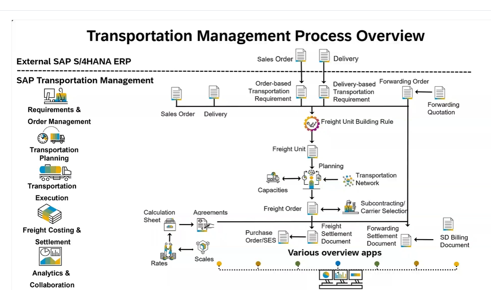
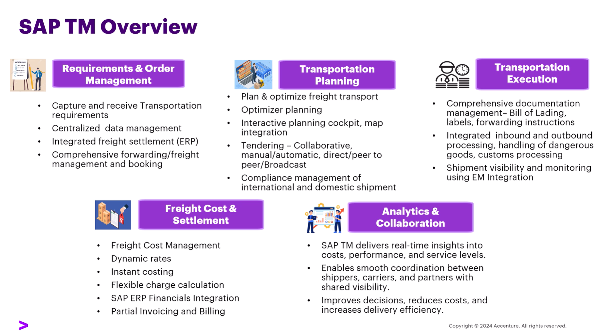
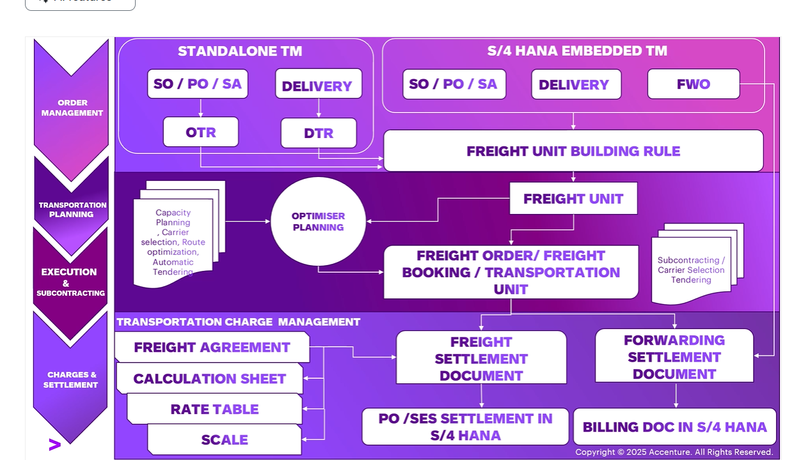
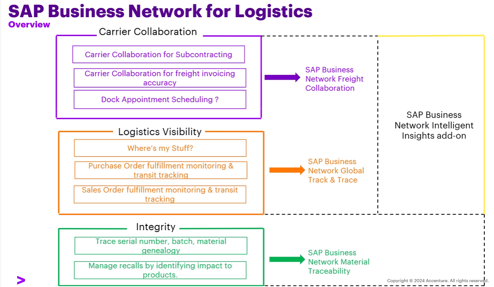

### Introduction to BN4L
- SAP Business Network for Logistics (BN4L) by SAP is a cloud collaboration portal that connects buyer/sellers(Shippers & LSP) with carriers or freight forwarders, and other logistics partners on a single network. 
- It is an extension of TM module for enhanced carrier collaboration that enable seamless communication and data exchange between organizations streamlining transportation process.

- `SAP TM:`  Plans and manages transportation.
- `SAP BN4L: ` Connects organizations and enables transportation collaboration.

### Module 1: SAP Introduction BN4L Introduction

#### SAP s/4 HANA TM Overview 

1. Framework pillars of SAP TM
   - Order management
   - Transportation planning
   - Transportation Exceution
   - Financial Anlytics(TCM & TCS)
2. SAP TM Process Flow Overview 
   

3. SAP TM Video PPT 

####  SAP Business Network 

1. SAP Business Network -Challenges, Benefits & Solutions
2. SAP Business Network Introduction
  - SAP Business network provides Suppliers,Logistics & service providers, Asset operators, Maintainence Contractors 

3. SAP Business Network Collaboration Coverage
4. SAP BN Supply chain collaboration
5. SAP Business Network Collaboration configuration

#### Major Challenges Faced in Supply Chain
1. Fog of Forecasting
   Unpredictable customer demand.

2. Managing Supplier Relationships
   Unreliable suppliers, inconsistent product quality, and poor communication.

3. Inventory Balancing
   Holding too much inventory or having too little.

4. Seeing Through the Supply Chain
   Not knowing where your shipments are, what your inventory levels look like in transit, or how your suppliers are performing in real-time.

5. Rising Cost of Moving Goods
   Fluctuating fuel prices, driver shortages, and the high cost of last-mile delivery.

####  SAP Business Network for Logistics (Overview / BN4L)   
1. Freight collaboration   
   Manage freight efficiently with standardized collaboration and insights   
2. Global track and trace   
   Differentiate through situational awareness and eased decision making
3. Material traceability   
   Create a trust chain for up- and downstream product genealogy  
4. Intelligent insights   
    Provide superior visibility and key performance indicators across regions, networks, and applications  

### Module 2 :SAP BN4L : System Set-up: Shipper & Carrier Onboarding

#### SAP BN4L Freight Collaboration Solution Architecture 

#### SAP Business Network for Logistics : Shipper Onboarding 

#### SAP Business Network for Logistics : Carrier Onboarding 

